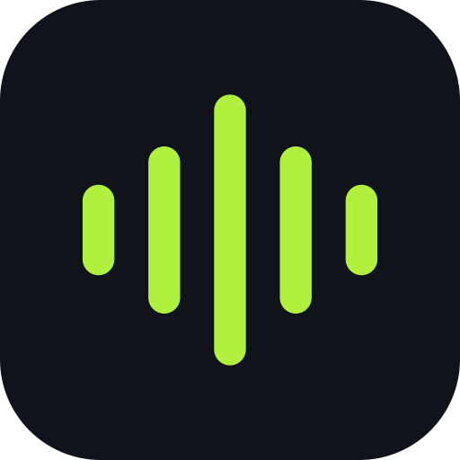

<p align="center">
  
</p>

<h1 align="center">Cueflow for Mac</h1>

<p align="center">
  Your DJ library, analysed and prepared on your Mac.<br>
  BPM, beatgrid, bar 1, key, structure and hot cues, exported to Rekordbox. Fully offline.
</p>

<p align="center">
  <a href="https://github.com/colasnaudi/cueflow-releases/releases/latest"><b>Download the latest version</b></a>
  ·
  <a href="https://cueflow.colasnaudi.com">Website</a>
  ·
  <a href="https://cueflow.colasnaudi.com/docs/">Docs</a>
  ·
  <a href="https://cueflow.colasnaudi.com/versions">What's new</a>
</p>

---

This repository only hosts the **downloads** of the Cueflow app. The app's source code is not public.

## Requirements

| | |
| --- | --- |
| **Mac** | Apple Silicon (M1, M2, M3, M4…). Intel Macs are not supported. |
| **macOS** | 15 Sequoia or later. |
| **Licence** | An activation code (one-time purchase, 2 Macs, every 1.x update). |
| **Internet** | Once, to activate. Cueflow then works offline. |

To check your Mac: Apple menu > **About This Mac**.

## Install

1. Download `Cueflow-x.y.z-arm64.dmg` from the [latest release](https://github.com/colasnaudi/cueflow-releases/releases/latest).
2. Open it and drag **Cueflow** to your **Applications** folder.
3. Launch Cueflow. It is not notarised by Apple yet, so the first time macOS blocks it: click **Done**.
4. Open **System Settings** > **Privacy & Security**, scroll down and click **Open Anyway** next to Cueflow, then confirm.
   You only do this once per version.
5. Paste your activation code and click **Activate**.

## Updates

Cueflow tells you when a new version is out (and from the menu: **Cueflow** > **Check for Updates…**).
Download it here, then replace Cueflow in your Applications folder: your library, your analyses and your licence
are kept. What each version brings, and how accurate its analysis is: [cueflow.colasnaudi.com/versions](https://cueflow.colasnaudi.com/versions).

## Check your download

Each release lists the SHA-256 of its DMG. In Terminal:

```bash
shasum -a 256 ~/Downloads/Cueflow-*-arm64.dmg
```

The result must match the one in the release notes.

## Your files stay yours

Cueflow reads your music folder and never rewrites a tag or a file. Analysis runs on your Mac; nothing from your
library is uploaded. Cleanup only ever moves files to the macOS Trash.

---

<details>
<summary><b>En français</b></summary>

<br>

**Cueflow** analyse et prépare ta bibliothèque DJ sur ton Mac : BPM, beatgrid, première mesure, tonalité,
structure et hot cues, exportés vers Rekordbox. Tout hors ligne.

**Configuration :** un Mac Apple Silicon (M1 ou plus récent) avec macOS 15 Sequoia ou plus récent, et un code
d'activation (paiement unique, 2 Mac, toutes les mises à jour 1.x).

**Installation :**

1. Télécharge le DMG de la [dernière version](https://github.com/colasnaudi/cueflow-releases/releases/latest).
2. Ouvre-le et glisse **Cueflow** dans **Applications**.
3. Lance Cueflow. Il n'est pas encore notarisé par Apple : la première fois, macOS le bloque. Clique sur **Terminé**.
4. Ouvre **Réglages Système** > **Confidentialité et sécurité**, descends et clique sur **Ouvrir quand même**, puis
   confirme. Une seule fois par version.
5. Colle ton code d'activation et clique sur **Activate**.

**Mises à jour :** Cueflow te prévient quand une nouvelle version sort. Télécharge-la ici et remplace l'app dans
Applications : ta bibliothèque, tes analyses et ta licence sont conservées.
[Ce que chaque version apporte](https://cueflow.colasnaudi.com/versions).

</details>

<p align="center"><sub>© 2026 Colas Naudi · <a href="https://cueflow.colasnaudi.com/legal/licences.html">Open source licences</a></sub></p>
